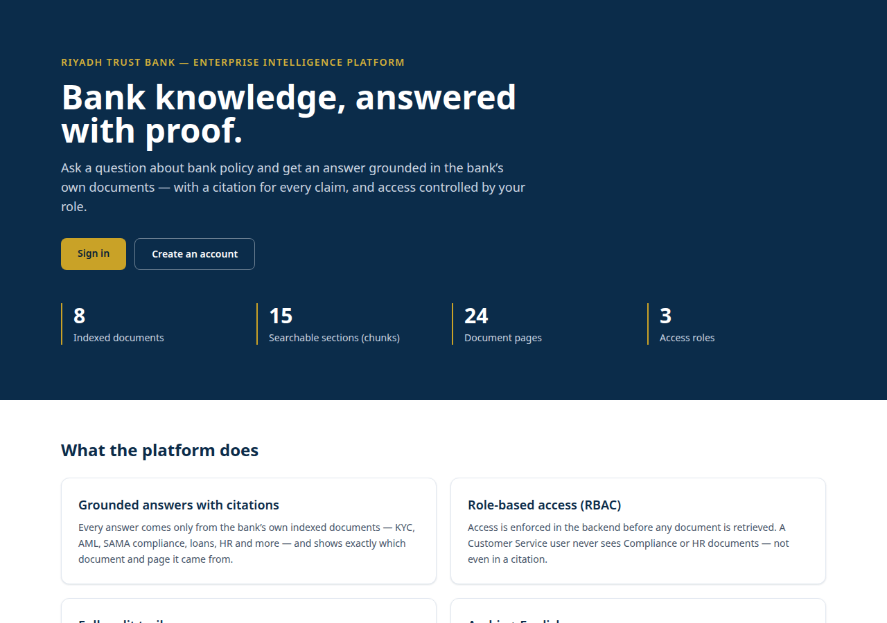
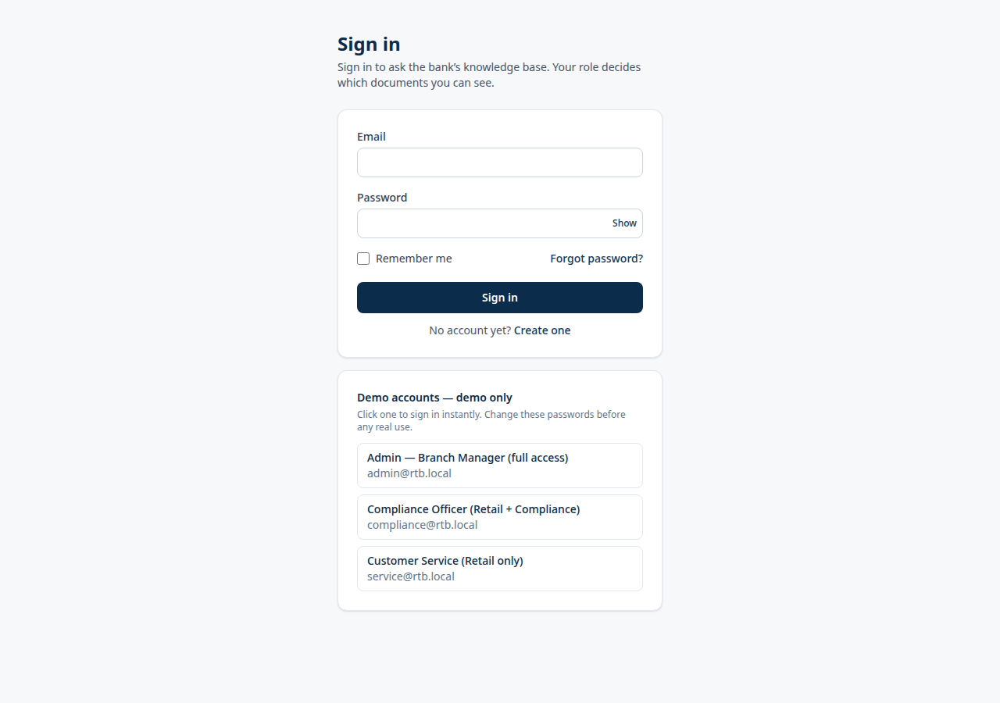
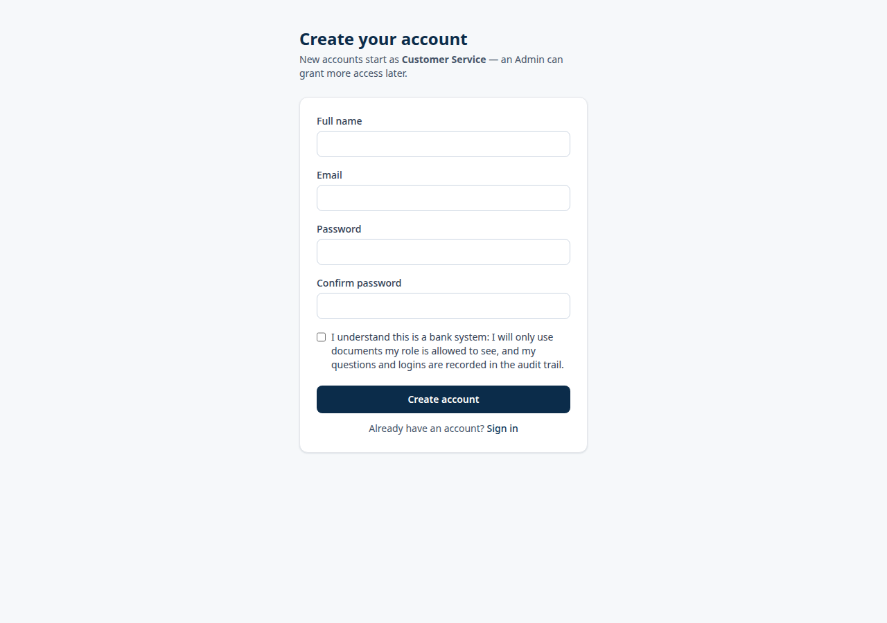
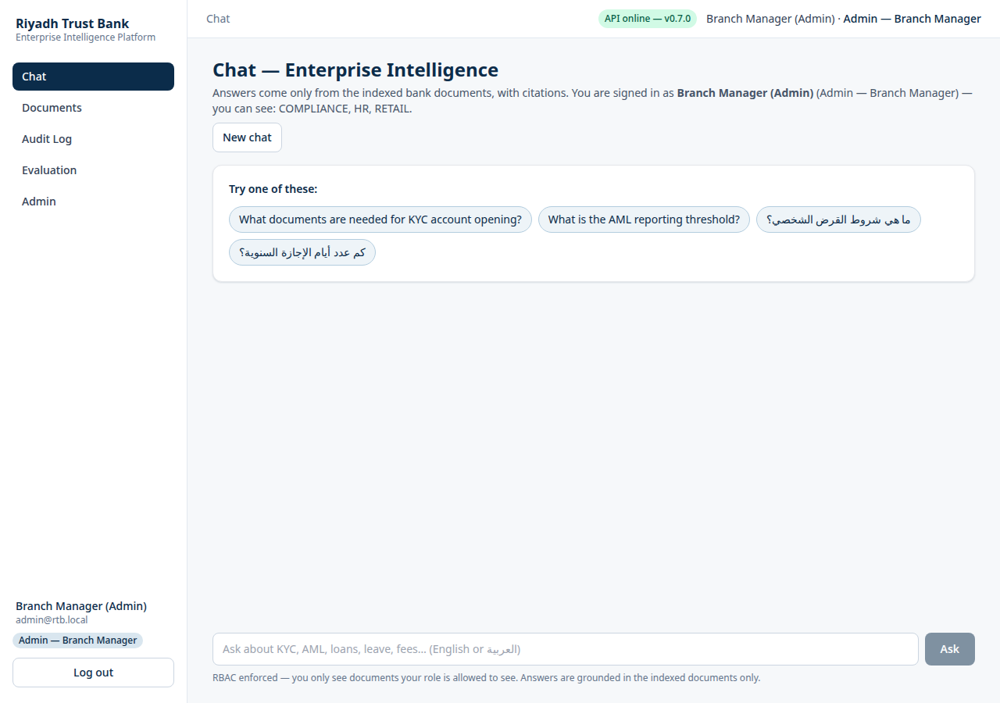
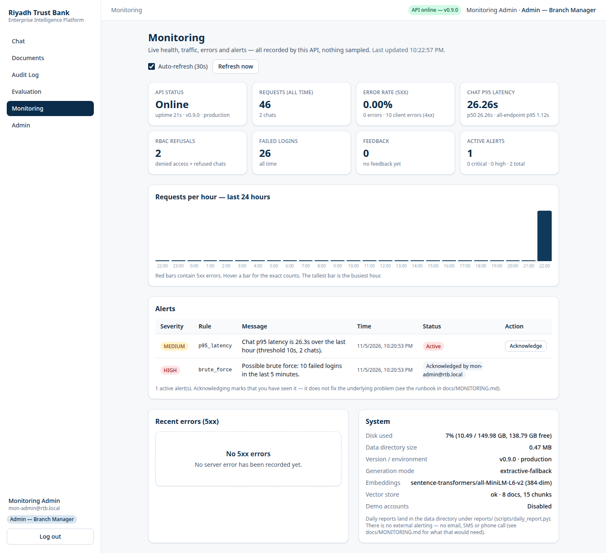
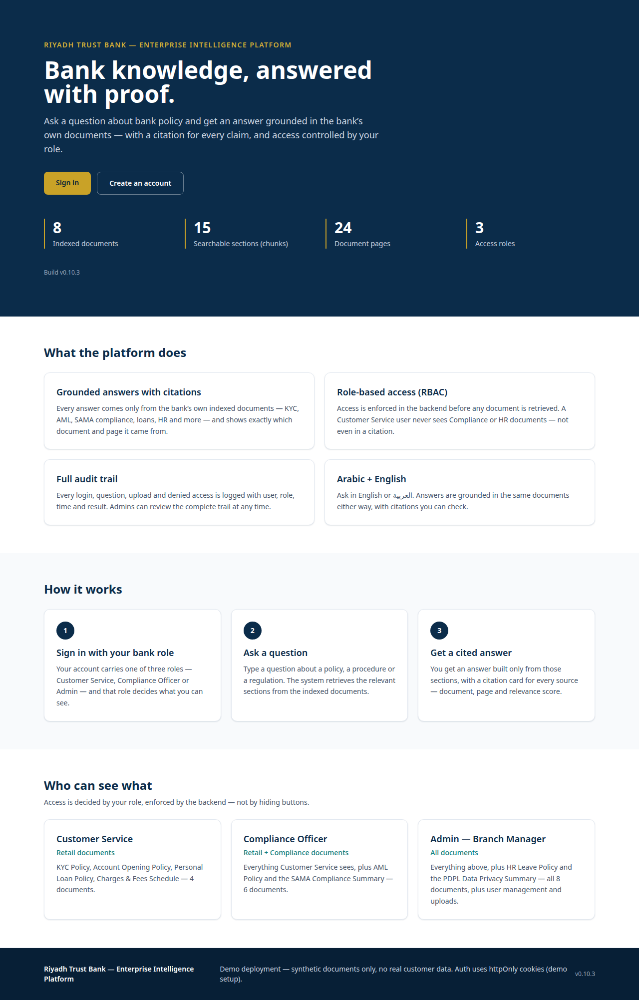

# Riyadh Trust Bank — Enterprise Intelligence Platform


> **Enterprise Intelligence Platform for a fictional Saudi bank** — ask policy questions and get grounded answers with a citation for every claim, with access controlled by your role. **Project 1 of an 11-project Saudi enterprise AI portfolio.**

## What it is

Employees at a bank waste hours hunting for the right policy, contract, or compliance memo. This platform indexes the bank's own documents (KYC, AML, SAMA compliance, loans, HR, PDPL) and answers questions **only from those documents** — every answer carries citations (document + page + relevance score), and role-based access control is enforced in the backend **before** any document is retrieved, so a Customer Service user never sees Compliance or HR documents, not even in a citation.

- **Fictional bank, synthetic data only.** "Riyadh Trust Bank" is not a real bank. All 8 documents (24 pages) are fictional, created for this demo. **No real customer data, ever.**
- **Local-first, $0.** Runs on a laptop without Docker or any cloud service: Python venv + Node + local PostgreSQL. No paid APIs, no paid LLM — answers run in extractive-fallback mode until Ollama is installed.
- **Full process, one project at a time:** Requirements → Estimate → Design → Setup → Development (4 sprints) → Testing → Staging → Production → Monitoring. This repo is the finished Project 1 (v0.10.2).

## Features

- **RAG chat with citations** — hybrid retrieval (vector top-20 + BM25 top-20 → RRF → cross-encoder rerank top-5); every answer cites document, page, and score; out-of-scope questions get a clear refusal instead of an invented answer.
- **Sign in / Sign up** — real registration (new accounts default to the lowest-privilege `CUSTOMER_SERVICE` role); JWT access (15 min) + refresh (24 h) tokens delivered as httpOnly cookies (never in localStorage), with rotation and logout revoke; admin password reset and a forgot-password request flow (no email — the admin sets a new temporary password).
- **Role-based access (RBAC)** — Customer Service sees RETAIL only (4 docs), Compliance Officer RETAIL + COMPLIANCE (6 docs), Admin all 8 docs incl. HR/PDPL. Enforced in the backend before retrieval, including a deterministic topic gate that refuses blocked topics (e.g. AML for Customer Service) before any retrieval runs. Admins can change user roles.
- **Audit trail** — every login, question, upload, and denied access is logged (user, role, time, result); Admin can review it in the dashboard.
- **Documents** — upload (PDF/Word/Excel, OCR fallback), list, search, delete; ingestion with section-aware chunking (8 docs → 15 chunks).
- **Evaluation** — local RAGAS-style eval (faithfulness, context recall, answer relevancy) on a 20-question set, plus user feedback (thumbs up/down) on every answer.
- **Monitoring** — every request recorded (endpoint, status, latency, role); 6 alert rules (brute force, error rate, p95 latency, RBAC spike, API down, disk usage); Admin `/monitoring` dashboard with live cards, hourly chart, alerts + acknowledge; daily report generator; log rotation.
- **Production hardening** — demo accounts OFF in production, fail-fast on weak JWT secret / wildcard CORS, security headers, login/register rate limiting (429), 10 MB upload limit, backup/restore scripts, extended `/health`.
- **Professional frontend** — React 18 + TypeScript + Tailwind: landing page, Sign In/Sign Up (password strength meter), sidebar app shell, chat with citation cards, documents table, audit log, admin panel, monitoring dashboard. Arabic + English.

## Tech stack

| Layer | Tech |
|---|---|
| Backend | FastAPI, Python 3.12, Pydantic, LangGraph (design) |
| Retrieval | pgvector (HNSW) + BM25 + BGE-M3 embeddings (fallback: all-MiniLM-L6-v2, 384-dim) + cross-encoder reranker |
| Database | PostgreSQL 16 + pgvector (local file store default; pgvector path live-tested against local PostgreSQL 16 + pgvector 0.6.0) |
| Frontend | React 18, TypeScript, Vite, Tailwind CSS, React Router |
| OCR | PaddleOCR (fallback, never faked) |
| Auth | JWT + bcrypt in httpOnly cookies, refresh-token rotation |
| Monitoring | JSONL metrics/alerts, `monitor_check.py`, daily reports |
| Tests | pytest (backend), `tsc` + Vite build (frontend) |

## Screenshots








## Quick start

**You need:** Python 3.12+, Node.js 20+, PostgreSQL (local, port 5432). Docker, Redis, Ollama are **not** required.

### Development (Windows PowerShell)

```powershell
# 1. Copy the example env and set a secret
copy .env.example .env

# 2. Backend — Terminal 1
cd backend
python -m venv venv
.\venv\Scripts\Activate.ps1
pip install -r requirements.txt
python ..\scripts\seed_users.py   # demo users (DEMO ONLY — see below)
uvicorn app.main:app --reload --port 8000
# Health: http://127.0.0.1:8000/api/v1/health
# API docs: http://127.0.0.1:8000/docs

# 3. Frontend — Terminal 2
cd frontend
npm install
npm run dev
# Open: http://localhost:3000
```

Linux: same steps with `./scripts/production_setup.sh` / `staging_setup.sh` — see `docs/SETUP.md`, `docs/STAGING.md`, `docs/PRODUCTION.md`.

### Production (local, $0 — no cloud)

```powershell
.\scripts\production_setup.ps1        # venv + secret + data-prod + index + frontend build
python scripts\create_admin.py --email you@bank.local   # first admin (demo users are NOT seeded)
.\scripts\production_start.ps1         # API :8000
.\scripts\production_start_web.ps1     # Web :3000
python scripts\production_smoke.py     # smoke test
python scripts\backup.py               # backup data-prod/
```

### Demo accounts (demo only)

| Role | Email | Password |
|---|---|---|
| Admin | admin@rtb.local | Admin123! |
| Compliance Officer | compliance@rtb.local | Compliance123! |
| Customer Service | service@rtb.local | Service123! |

**These are public demo credentials. Change them before any real use, and never enable them in production** (`RTB_DEMO_ACCOUNTS=0` in production; the app refuses to start with a weak secret or wildcard CORS).

## Verified results

All numbers below were measured live on the test VM and recorded in `docs/` — nothing here is estimated.

- **pytest: 141 passed, 1 skipped, 0 failed** (health, ingestion, RAG, RBAC incl. 12+ negative tests, feedback/eval, production, monitoring, cookies, password reset, topic gate, pgvector fallback).
- **End-to-end journeys: 25/25 PASS** (Customer Service, Compliance Officer, Admin, attacker, refusals) — `docs/TESTING.md`.
- **Staging smoke: 22/22 PASS** (API :8001, web :3001) — `docs/STAGING.md`.
- **Production smoke: 18/18 PASS** (demo login 401, rate-limit 429, security headers, RBAC) — `docs/PRODUCTION.md`.
- **Frontend smoke: 13/13 PASS** (register → login → chat → role change) — `docs/FRONTEND.md`.
- **RAG: 10/10 questions correct** (6 English + 4 Arabic) + refusal PASS.
- **Eval (20 questions, Admin, extractive mode):** faithfulness **1.00**, context recall **1.00**, answer relevancy **0.42**, top-doc 19/20.

## Project structure

```
frontend/   React 18 + TypeScript + Vite + Tailwind (Landing, Login/Register, Chat, Documents, Audit, Admin, Monitoring)
backend/    FastAPI (app/main.py, app/core, app/db, app/api/v1, app/services, app/monitoring)
scripts/    setup/start/smoke/backup/restore/monitor/daily-report/rotate-logs (PowerShell + bash)
tests/      pytest suite (health, ingestion, RAG, RBAC, auth, feedback/eval, production, monitoring)
data/       synthetic docs (data/docs/*.pdf + sources in data/docs_src/*.md), chunks, eval results
docs/       SETUP, SPRINT1–4, TESTING, STAGING, FRONTEND, PRODUCTION, MONITORING, LANDING-FIX
infra/      docker-compose.optional.yml (OPTIONAL only — Docker is not required)
```

## Docs

- `docs/SETUP.md` — detailed setup · `docs/SPRINT1.md` — ingestion + vector DB · `docs/SPRINT2.md` — RAG + citations · `docs/SPRINT3.md` — login, RBAC, audit, admin UI · `docs/SPRINT4.md` — evaluation + polish · `docs/TESTING.md` — test report (CONDITIONAL GO) · `docs/STAGING.md` — staging environment · `docs/FRONTEND.md` — professional redesign + auth · `docs/PRODUCTION.md` — production hardening + runbook · `docs/MONITORING.md` — metrics, alerts, dashboard · `docs/LANDING-FIX.md` — landing page fix (v0.9.1) · `docs/LIMITATIONS-FIX.md` — v0.10.0 fix report (what was closed, what stays PC-only) · `docs/LOGIN-FIX.md` — login bounce fix (v0.10.2)

---

## Build history (v0.1 → v0.10.2)

> The section below is a chronological build log, written as each version was completed. Some older lines describe the state at the time, when a feature had not been built yet; the current state is described in "What it is" above. No facts have been removed.

> **No Docker required — this setup runs without Docker.**
> Docker does not run on Fahad's laptop (BIOS password-locked, VT-x disabled).
> The primary setup is therefore **local Windows**: Python venv + Node + local PostgreSQL.
> Docker is optional only (`infra/docker-compose.optional.yml`) — for machines where Docker does run.

Enterprise Intelligence Platform for a fictional Saudi bank (Riyadh Trust Bank) — a portfolio project, not a real company, with no real customer data.

Status: **v0.10.2 DONE — Login bounce fixed.** Browser login no longer bounces back to the sign-in page: the frontend now calls the API on the same host the page was opened on (localhost or 127.0.0.1), so the SameSite=Lax httpOnly cookies are sent on every request, and CORS allows both local host spellings. Verified in a real headless browser from both hosts (login → chat → reload still logged in → logout). Details in `docs/LOGIN-FIX.md`.

Status: **v0.10.1 DONE — No Roman Urdu.** Every user-facing string, API message, doc, and code comment is now 100% professional English: demo account labels, feedback message, RBAC and general refusals, system prompt, and all docs (PRODUCTION, STAGING, SETUP, LANDING-FIX, SPRINT2, SPRINT4, TESTING). Full wordlist scan: 0 matches. Pytest 142 passed.

Status: **Fixes v0.10.0 DONE — Project 1 COMPLETE.** httpOnly cookie auth (tokens out of localStorage, SameSite=Lax + Origin check), admin password reset + forgot-password request flow, Arabic PDFs regenerated in logical order (ReportLab + uharfbuzz), deterministic RBAC topic gate (the reported "AML policy for high-risk customers?" case is now refused with 0 citations), English latency improved 7.13 s → 3.53 s median (probe now uses the score reranker; < 3 s still needs a stronger PC), PgVector path live-tested against local PostgreSQL 16 + pgvector 0.6.0. Details in `docs/LIMITATIONS-FIX.md`.
Monitoring (v0.9): request metrics (`metrics.jsonl`, every request is recorded), 6 alert rules (brute force, error rate, p95 latency, RBAC spike, API down, disk), `scripts/monitor_check.py` (every 5 min, exit 0/1/2), `scripts/daily_report.py`, `scripts/rotate_logs.py`, Admin Monitoring dashboard (`/monitoring`, live cards + hourly chart + alerts + acknowledge). Pytest **99 passed** (81 existing + 18 new); live verification: brute-force HIGH and p95 MEDIUM alerts fired on real traffic. Details in `docs/MONITORING.md`. PC-only pending list (Ollama, PgVector, latency, eval, httpOnly cookies) — `docs/MONITORING.md` §8.
Production hardening: demo accounts OFF (`RTB_DEMO_ACCOUNTS=0`, fail-fast on weak JWT secret / wildcard CORS), security headers,
login/register rate limiting (429), 10 MB upload limit, extended `/health`, `scripts/create_admin.py`, backup/restore, production
runbook. Details in `docs/PRODUCTION.md`. "Production" here means local production (on Fahad's PC, $0, no cloud) — there is no fake
cloud deployment. Next step: Monitoring.
Professional frontend redesign (landing, Sign In/Sign Up, sidebar app shell, chat, documents, audit log,
admin + evaluation) + real register endpoint (auto-login, CUSTOMER_SERVICE default) + Admin role change.
Pytest **69 passed** (57 existing + 12 new), live smoke on staging **13/13 PASS**. Details in `docs/FRONTEND.md`.
Testing: **CONDITIONAL GO** (docs/TESTING.md) — 57 tests + 25/25 journeys pass, RBAC airtight; English latency 4–8 s
(target < 3 s) and Arabic garbling / relevancy 0.42 were recorded at Testing time (v0.10.0 fixes them — see `docs/LIMITATIONS-FIX.md`).
Evaluation (local RAGAS-style, no LLM judge) and feedback are done — details in `docs/SPRINT4.md`.
Eval results (20 questions, ADMIN): faithfulness **1.00** ✅, context recall **1.00** ✅, answer relevancy **0.42** ❌ (target 0.85 —
MiniLM is English-only and cannot judge Arabic; a real LLM + BGE-M3 will fix this). Next step: Production → Monitoring.

## Monitoring (v0.9, NEW)
Local-first, $0, no external service: every request is recorded in `metrics.jsonl`; alerts go to `alerts.jsonl`; the Admin dashboard is at `/monitoring`. Details: `docs/MONITORING.md`.
```powershell
python scripts\monitor_check.py --port 8000 --data-dir data-prod   # every 5 min (Task Scheduler) — exit 0 ok / 1 alert / 2 critical-down
python scripts\daily_report.py --data-dir data-prod                 # daily — data-prod/reports/daily-YYYY-MM-DD.md
python scripts\rotate_logs.py --data-dir data-prod                  # weekly — archive when over 10k lines (max 7 archives)
```

## Production (v0.8)
Local production on this machine ($0, no cloud): API **:8000**, web **:3000**, data **data-prod/** (dev and staging data untouched),
DEBUG off, fresh JWT secret, demo accounts OFF. Details: `docs/PRODUCTION.md`.
```powershell
.\scripts\production_setup.ps1        # Windows: venv + secret + data-prod + index + frontend build
python scripts\create_admin.py --email you@bank.local   # first admin (demo users are NOT seeded)
.\scripts\production_start.ps1         # start API :8000
.\scripts\production_start_web.ps1     # start web :3000
python scripts\production_smoke.py     # smoke test (health, headers, demo 401, register, chat, RBAC, 429)
python scripts\backup.py               # back up data-prod/
```
Linux: `./scripts/production_setup.sh` / `./scripts/production_start.sh` / `./scripts/production_start_web.sh` — same steps.

## Staging (v0.6)
Same code, separate environment: API **:8001**, web **:3001**, data **data-staging/** (dev data untouched), DEBUG off,
fresh JWT secret. Details: `docs/STAGING.md`.
```powershell
.\scripts\staging_setup.ps1        # Windows: venv + secret + data-staging + index
.\scripts\staging_start.ps1        # start API :8001
python scripts\staging_smoke.py    # smoke test (health, 3 roles, EN/AR chat, RBAC, feedback)
```
Linux: `./scripts/staging_setup.sh` / `./scripts/staging_start.sh` — same steps.

## What was built (v0.4 — Sprint 3; Sprint 2 below)
- **Login + JWT (Sprint 3, NEW):** `POST /api/v1/auth/login` (access 15 min
  + refresh 24 h, rotation + logout revoke), `POST /api/v1/auth/refresh`,
  `POST /api/v1/auth/logout`, `GET /api/v1/auth/me`. Seed demo users with:
  `python scripts/seed_users.py` — admin@rtb.local / Admin123! (ADMIN),
  compliance@rtb.local / Compliance123! (COMPLIANCE_OFFICER),
  service@rtb.local / Service123! (CUSTOMER_SERVICE). **DEMO ONLY — change
  the passwords before any real use.**
- **RBAC (Sprint 3, NEW):** Enforced in the backend — chat, documents list,
  upload, admin. Customer Service sees RETAIL only (4 docs), Compliance RETAIL +
  COMPLIANCE (6 docs), Admin all (8 docs). HR documents (HR Leave + PDPL)
  are ADMIN only. A wrong role never receives a citation for a disallowed
  document — Customer Service gets a refusal on AML questions.
- **Audit log (Sprint 3, NEW):** Every LOGIN / QUERY / UPLOAD /
  ACCESS_DENIED is recorded in `data/audit.jsonl` (and in the `audit_logs`
  table when Postgres is used). View it in the Admin dashboard: `GET /api/v1/admin/audit-logs`.
- **Admin UI (Sprint 3, NEW):** Users, documents, and audit-log tables —
  all from the real API, no fake rows. The login page has 3 clickable DEMO
  account buttons; the Chat page shows the user + role badge.
- **Tests:** `tests/test_health.py` + `tests/test_ingestion.py` +
  `tests/test_rag.py` + `tests/test_rbac.py` — **43 passed, 0 failed**.
- **Synthetic documents:** 8 PDFs (24 pages) — KYC, AML, SAMA Compliance,
  Personal Loan, Account Opening, HR Leave, Charges & Fees, PDPL. All fictional,
  English + Arabic summary. Sources: `data/docs_src/*.md`, regenerate with
  `python scripts/generate_docs.py`.
- **Ingestion:** `backend/app/services/ingestion.py` — PDF (PyMuPDF), Word,
  Excel; OCR fallback (PaddleOCR, warning if missing, never faked);
  section-aware chunking (~800 tokens, ~150 overlap). CLI:
  `python -m app.services.ingestion --docs ../data/docs --out ../data/chunks.jsonl`
  Result: 8 docs, 15 chunks, avg 528.1 tokens.
- **Embeddings + Vector DB:** embedding model recorded in
  `data/vector_store/embedding_config.json` (BGE-M3 tried first, fallback
  recorded honestly). Local file store in `data/vector_store/` (default,
  no Postgres needed) + Postgres/pgvector store code (`RTB_USE_PGVECTOR=1`).
  Index: `python scripts/index_chunks.py`. Search test: `python scripts/search_test.py`.
- **API (new):** `GET /api/v1/documents` (list) and
  `POST /api/v1/documents/upload` (ingest + index). RBAC **not enforced yet**
  (Sprint 3) — stated clearly in the response.
- **Frontend:** React 18 + TypeScript + Vite + Tailwind scaffold — Login / Chat / Admin pages, real routing, fetches `/api/v1/health` to show live API status. No fake chat answers.
- **Backend:** FastAPI — `/api/v1/health`, `/api/v1/metrics`, documents endpoints
  real and working. The remaining 10 endpoints are honest 501 stubs.
- **RAG chat (Sprint 2, NEW):** `POST /api/v1/chat` — hybrid retrieval
  (vector + BM25 -> RRF -> rerank) + grounded answer with citations.
  `GET /api/v1/conversations` lists conversations, `GET /api/v1/conversations/{id}`
  returns saved messages. Generation modes: Ollama LLM (if running)
  or extractive-fallback (this is what ran on this VM — answers are built only from retrieved
  chunks, nothing is invented). Out-of-scope questions get a
  refusal: "This information is not in the documents". Test: 10/10 questions
  correct + refusal OK. Details: `docs/SPRINT2.md`.
- **Frontend Chat (Sprint 2, NEW):** The Chat page is real now — type a question,
  the answer comes from `/api/v1/chat`, with citations (title + page + score) and a
  generation-mode badge. No fake answers.
- **Tests:** `tests/test_health.py` + `tests/test_ingestion.py` +
  `tests/test_rag.py` — **20 passed, 0 failed**.

## Not yet built (note from v0.4 — everything is built now, see above)
- Production deployment, Monitoring (Langfuse dashboards) — steps after Staging.

Details: `docs/SPRINT1.md`, `docs/SPRINT2.md`, `docs/SPRINT3.md`, `docs/SPRINT4.md`, `docs/TESTING.md`, `docs/STAGING.md`

## Quick start — Windows (PowerShell), no Docker

**Requirements:** Python 3.12+, Node.js 20+, PostgreSQL (local, port 5432 — already installed). Docker, Redis, Ollama are **not** required.

```powershell
# 1. Open the project folder
cd riyadh-trust-bank-intelligence

# 2. Create .env (copy, don't edit — change the secret)
copy .env.example .env

# 3. Backend — Terminal 1
cd backend
python -m venv venv
.\venv\Scripts\Activate.ps1
pip install -r requirements.txt
python ..\scripts\seed_users.py   # create demo users (admin/compliance/service)
uvicorn app.main:app --reload --port 8000
# Check: http://127.0.0.1:8000/api/v1/health  -> {"success": true, "data": {"status": "ok", ...}}
# API docs: http://127.0.0.1:8000/docs

# 4. Frontend — Terminal 2
cd frontend
npm install
npm run dev
# Open: http://localhost:3000  (the header should show "API online")
```

**Database:** `.env` has `DATABASE_URL=postgresql://localhost:5432/rtb_intelligence`.
Create the database once: `createdb rtb_intelligence` (or via pgAdmin).
If PostgreSQL is not running, Setup still works — the DB wiring is in Sprint 1, and the skeleton falls back to a local SQLite file. The pgvector extension is added in Sprint 1, not required for Setup.

**Redis / Celery:** Optional. The backend runs without Redis (health OK). Worker in Sprint 1.

**Ollama (LLM, local):** Installed separately via the Windows installer, no Docker needed: https://ollama.com/download/windows — **not** required for Setup; the health check passes without Ollama. Models (`llama3.1:8b`, `qwen2.5:7b`) are downloaded in Sprint 2.

**Docker (optional, for other machines only):** `infra/docker-compose.optional.yml` — do **not** run it on Fahad's laptop.

## Tests
```powershell
cd backend
.\venv\Scripts\Activate.ps1
python -m pytest ../tests/ -v
# 57 passed (health 3 + ingestion 10 + RAG 7 + RBAC 23 + feedback/eval 14)
```

## Structure
```
frontend/   React + TS + Vite + Tailwind
backend/    FastAPI (app/main.py, app/core, app/db, app/api/v1)
infra/      docker-compose.optional.yml (OPTIONAL only)
data/       empty — synthetic docs in Sprint 1
tests/      test_health.py
docs/       SETUP.md (detailed steps)
```
